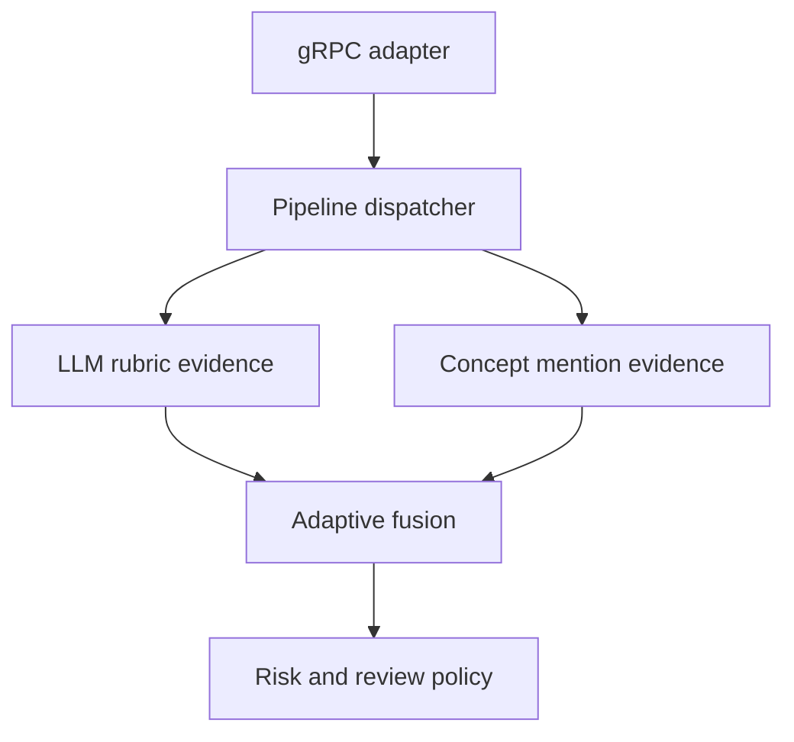

# Standalone document evaluation

Scope: extracted text → rubric evidence + literal concept coverage → adaptive fusion → review indicator. Existing `EvaluateCriteria` and `GenerateSummary` RPCs remain compatibility adapters.



Run from the repository root:

```sh
dotnet test SGS.SemanticAnalysisTests/SGS.SemanticAnalysisTests.csproj
dotnet run --project SemanticAnalysis.Service
```

Configure `Auth__ApiKey`, `SemanticKernelSettings__ApiKey`, `SemanticKernelSettings__Endpoint`, `SemanticKernelSettings__DeploymentName`, `SemanticKernelSettings__Provider=AzureOpenAI` (default) or `OpenAI` (compatible endpoint), and optionally `SemanticKernelSettings__Language=ua`. Authenticate gRPC calls with `x-api-key`. The existing launch profile supplies the local ports; use TLS for remote hosting.

Import `Protos/semantic_analysis.proto` in Postman and invoke `EvaluateDocument`:

```json
{
  "documentText": "Independent encoding enables fast vector similarity retrieval.",
  "question": "Explain how a bi-encoder retrieves documents.",
  "maxScore": 10,
  "criteria": [{
    "id": "mechanism", "description": "Explain independent encoding and vector similarity.",
    "maxScore": 10, "weight": 1,
    "concepts": [
      {"id": "encoding", "alternatives": ["independent encoding", "encoded independently"], "required": true},
      {"id": "similarity", "alternatives": ["vector similarity"]}
    ]
  }]
}
```

Each criterion has its own scale; provider scores normalize to [0,1]. Relative criterion weights normalize by their sum. Fusion uses `alpha = 0.8 - 0.3 * abs(LLM - coverage)` and `H = alpha * LLM + (1-alpha) * coverage`. Total grade scales the weighted mean to request `maxScore` (default 100).

Risk is `0.6 * mean(disagreement) + 0.4 * anyMissingRequiredConcept`. Missing required concepts, a prompt retry, risk ≥ 0.3 or any criterion disagreement ≥ 0.5 force review. Provider failure returns risk 1, review required and an **absent score**, never a fabricated zero grade.

This is a rule baseline: concept mentions do not prove correctness, detect negation or establish semantic equivalence. Quotes establish provenance, not factual accuracy. Risk and thresholds are uncalibrated; no probability or grading-quality improvement is claimed. Live-model validation remains pending.

Extension: implement/register another `IEvaluationPipeline` with a unique name and its own providers/strategies; select it through request `pipeline`. Add providers through `IGradingEvidenceProvider`; replace `IGradeFusionStrategy` and `IRiskEstimator` independently. Required sources and fusion are specific to `open-answer-v1`; new work types should define their own composition.

Verified: 32 deterministic tests (including gRPC transport and the real connector with a fake HTTP model), existing client build, and publish-time prompt inclusion. No live-model quality experiment has been run.
